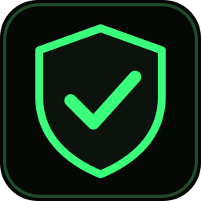
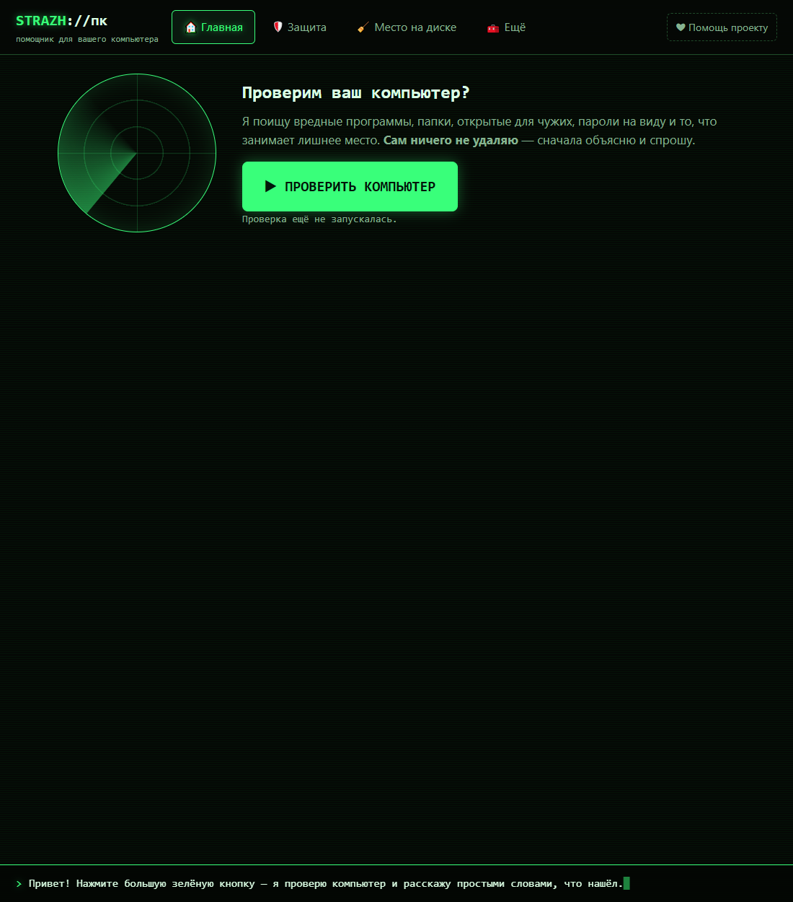
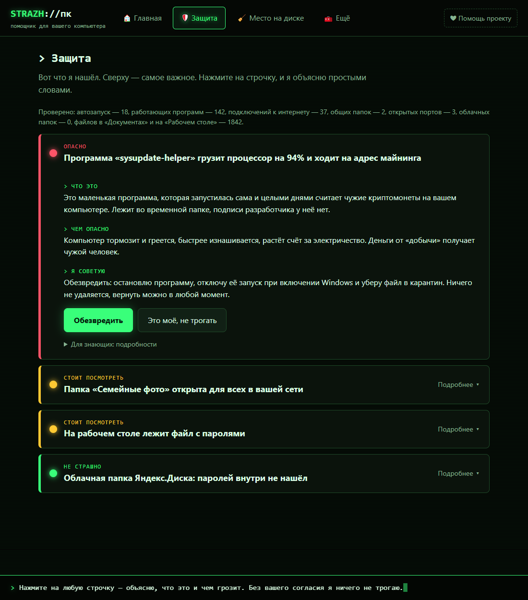
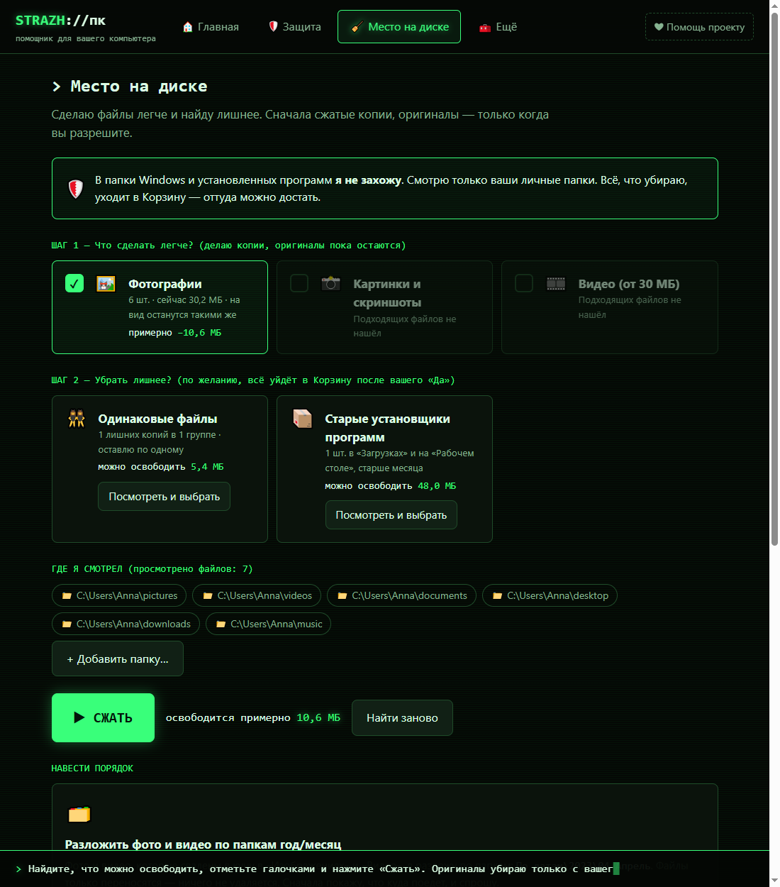
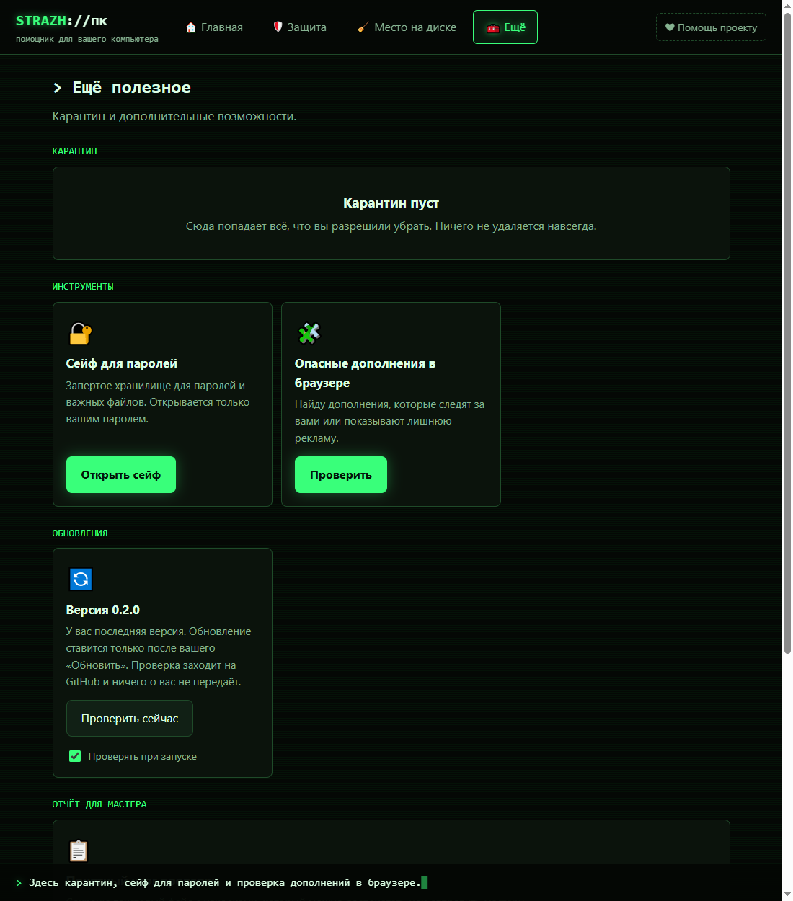
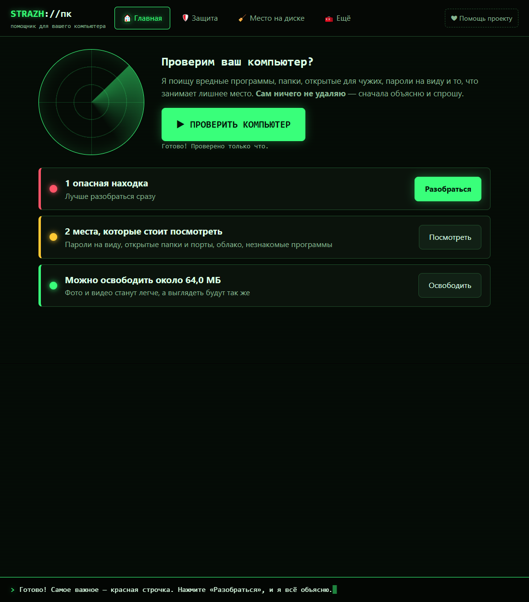

<p align="center"></p>

# Страж ПК

[](https://github.com/OlegChe77/strazh-pc/releases/latest)
[](https://github.com/OlegChe77/strazh-pc/releases)


[](LICENSE)
[](https://dalink.to/olegche)

**Помощник для вашего компьютера**, который объясняет всё простыми словами. Ищет вредные программы, майнеры, открытые для чужих папки и пароли «на виду», а ещё сжимает фото и видео и наводит порядок, чтобы освободить место на диске.

Это **не антивирус** и не «чистильщик, который всё сделает сам». Страж ПК смотрит, объясняет и **спрашивает**. Без вашего «Да» он ничего не удаляет и не переносит.

⬇️ **[Скачать Страж ПК для Windows](https://github.com/OlegChe77/strazh-pc/releases/latest)** (установщик `StrazhPC-Setup-….exe` или версия без установки `StrazhPC-Portable-….exe`)

<p align="center"></p>

## Что умеет

### 🛡️ Защита: что нашёл и чем это грозит

Одна кнопка «Проверить компьютер». Каждая находка помечена как светофор: **Опасно** · **Стоит посмотреть** · **Не страшно**. У каждой три пояснения без терминов: *что это*, *чем опасно*, *я советую*. Путь к файлу спрятан в «Для знающих».

<p align="center"></p>

Что проверяется:

| Проверка | Что ищет |
|---|---|
| Автозагрузка и планировщик | программы, которые сами запускаются при включении Windows, без подписи, из временных папок |
| Работающие программы | подозрительные процессы, майнеры, подделки под системные имена |
| Сетевые подключения | связь с адресами майнинг-пулов |
| Общие папки | папки, открытые по сети для всех |
| Открытые порты | удалённый рабочий стол, VNC, telnet, FTP, базы данных, Docker. Смотрит на брандмауэр и защиту входа |
| Облачные папки | OneDrive, Яндекс.Диск, Google Диск, Dropbox, Облако Mail.ru: нет ли внутри паролей и ключей |
| Пароли и личные данные | в «Документах» и на «Рабочем столе» |
| Дополнения браузеров | Chrome, Edge, Brave, Vivaldi, Яндекс, Opera, Firefox: лишние права и установка не из магазина |

Своей базы вирусов нет: программа смотрит на подписи файлов, место запуска, нагрузку и подключения, а потом объясняет вывод. Файлы «только в облаке» не читаются, иначе облако стало бы их скачивать.

### 🧹 Место на диске

Сжимает фото (JPEG, PNG) и видео **без заметной потери качества**, находит одинаковые файлы и старые установщики программ. Сначала делает сжатые копии, оригиналы убирает только после вашего «Да», и то в Корзину. Папки Windows и установленных программ не трогает.

<p align="center"></p>

- **Разложить по папкам год/месяц.** Дата берётся из снимка (EXIF), потом из имени, потом из даты файла. Только перенос, есть «Вернуть как было».
- **Копии раз в неделю.** Задание Планировщика Windows делает сжатые копии без окна, оригиналы не трогает.

### 🧰 Ещё

<p align="center"></p>

- **Карантин.** Всё, что вы разрешили убрать, лежит в защищённой папке и возвращается одной кнопкой.
- **Сейф для паролей и файлов.** Шифрование AES-256-GCM, ключ из пароля (scrypt), закрывается сам через 10 минут. Пароль **нельзя восстановить**, храните его.
- **Отчёт для мастера.** Понятный текстовый итог, который можно распечатать или отправить знакомому.

После проверки главный экран показывает итог, а находки лежат в «Защите»:

<p align="center"></p>

## Принципы

- **Ничего не удаляется само.** Любое удаление или перенос только после явного «Да». Опасное убирается в карантин, а не стирается, и возвращается обратно.
- **Системные папки не трогаются** при уборке и сжатии. Туда заглядывает только поиск угроз, и каждую находку объясняет.
- **Без регистрации и телеметрии.** Все данные остаются на вашем компьютере. Единственное обращение к сети: проверка новой версии на GitHub (её можно выключить).
- **Для людей, которые не любят разбираться в компьютерах:** без терминов, одна главная кнопка на экране.

## Установка

1. Откройте [последний релиз](https://github.com/OlegChe77/strazh-pc/releases/latest).
2. Скачайте **`StrazhPC-Setup-….exe`** (установщик, обновляется сам) или **`StrazhPC-Portable-….exe`** (запускается без установки).
3. Запустите. Установка идёт в вашу папку пользователя, права администратора не нужны.

> Программа пока **не подписана цифровой подписью**, поэтому Windows SmartScreen может предупредить: «Windows защитила ваш компьютер». Нажмите «Подробнее» → «Выполнить в любом случае». Исходный код открыт, собрать можно самому (см. ниже). Некоторые антивирусы могут ругаться на неподписанные свежие сборки. Это ложное срабатывание.

## Автообновление

Установленная версия сама проверяет GitHub Releases при запуске. Если вышла новая, сверху появится полоска **«Вышла новая версия … [Обновить]»**. Скачивание и установка начинаются **только после вашего нажатия**, затем программа перезапускается уже новой. Версия `Portable` покажет ту же полоску, а кнопка откроет страницу загрузки. Проверку можно выключить или запустить вручную: «Ещё → Обновления».

## Для разработчиков

Нужны Node.js 22+ и Windows.

```bash
npm install
npm start            # запуск
npm run selftest     # проверка без окна
npm run dist         # установщик и portable в dist/
node scripts/shots.js  # скриншоты для README на вымышленных данных
```

Как устроено:

- `src/main/` — окно, IPC, проверки угроз (`threats/`), поиск и сжатие (`space/`), сейф (`vault.js`), карантин (`quarantine.js`), обновления (`updater.js`).
- `src/renderer/` — интерфейс (HTML/CSS/JS без фреймворков).
- `build/installer.nsh` — правка установщика: закрывает запущенную программу без WMI (на ПК со сломанным WMI стандартная проверка не работает).
- `scripts/` — самопроверка, скриншоты, сквозной прогон `e2e.js`, значок.

### Как выпустить новую версию

1. Поднимите `version` в `package.json` (например, `0.2.1`) и закоммитьте.
2. Поставьте тег и отправьте его:

   ```bash
   git tag v0.2.1
   git push origin main v0.2.1
   ```

3. GitHub Actions ([`release.yml`](.github/workflows/release.yml)) соберёт установщик и portable и опубликует релиз вместе с `latest.yml`. Установленные программы увидят обновление при следующем запуске.

## Помощь проекту

Программа бесплатная. Если она вам пригодилась, можно поддержать автора: **[dalink.to/olegche](https://dalink.to/olegche)** ❤. Та же кнопка есть в самой программе, в правом верхнем углу.

Нашли ошибку или есть идея? Напишите в [Issues](https://github.com/OlegChe77/strazh-pc/issues).

## Лицензия

[MIT](LICENSE) © olegche
